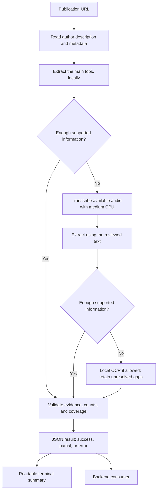

<div align="center">

# Video Extractor Summary

**Extract useful information from a reel. Keep the evidence.**

[](https://github.com/enros7500/video-extractor-summary/actions/workflows/ci.yml)


[Install](#installation) · [Usage](#usage) · [How it works](#how-it-works) · [Output](#output) · [Documentation](docs/README.md)

</div>

A local command-line tool that turns Instagram publications and YouTube videos into structured places, tools, products, recommendations, or steps. Use readable summaries in your terminal or integrate the JSON interface into another backend.

- **One publication, one main topic.** Extract the useful information without turning the result into a full transcript.
- **Description first.** Review the author's text before processing audio or images.
- **Local inference.** Whisper medium on CPU, Qwen2.5 3B, and local OCR.
- **Traceable results.** Preserve evidence, reviewed coverage, unknown values, and extraction gaps.
- **Clear interfaces.** JSON for software; readable conclusions for people.

## Installation

Clone or download the repository. From its root in PowerShell:

```powershell
.\install.cmd
```

The installer finds or installs Python 3.12 x64 and Ollama, prepares an isolated environment, installs the CLI with OCR, downloads medium and Qwen, and checks readiness. Existing matching model files are reused.

**Requirements:** Windows 10 22H2 or newer, x64, internet access, project write access, and WinGet when prerequisites are missing. Allow roughly 12 GB of free space for applications, dependencies, models, and caches. No CUDA GPU or API key is required.

```powershell
.\install.cmd -DryRun  # Preview the setup without changes
.\install.cmd -Check   # Check an installed environment without downloads
```

The installation is project-relative. No environment activation or manual PATH changes are needed. If setup fails, resolve the reported issue and rerun the installer. Package/model downloads obey the machine's proxy and registry configuration.

## Usage

**Readable summary**

```powershell
.\reel summary "REEL_URL"
```

**Structured JSON**

```powershell
.\reel "REEL_URL"
```

**Save the result and summarize it later**

```powershell
.\reel "REEL_URL" | Out-File outputs/result.json -Encoding utf8
.\reel summary --result outputs/result.json
```

Use a single Instagram post/reel or YouTube video URL. A saved-result summary requires neither network access nor model execution. Cancel a running extraction with **Ctrl+C**.

## How it works



Supported formats use evidence-backed rules; other formats use Qwen locally. The tool reports what was reviewed and what remains unknown. A sufficiency assessment can be wrong, so consumers should inspect coverage and gaps.

## Output

Given a tool walkthrough, expect **one tool and its ordered steps**. Given a list of recommendations, expect a recommendation collection with the announced count when it is supported by the publication.

For example, this author text:

> We built NotebookX. Type your username. Choose a template. Publish it to your profile.

Produces a tool and three steps. The readable output includes:

```text
Extracted information:
1. NotebookX — Tool presented by the author.
2. Type your username
3. Choose a template
4. Publish it to your profile

Conclusion: 4 item(s) extracted. The extractor marked the reviewed sources as sufficient.
This does not confirm full video coverage or verify identities, places, or links.
```

This is an illustrative text example. Complete synthetic JSON examples are available for [success](examples/success.json), [partial extraction](examples/partial.json), and [access errors](examples/error.json).

| Field | Meaning |
|---|---|
| `items`, `collections` | Extracted entities, recommendations, steps, grouping, and evidenced counts |
| `evidence` | Supporting author-description, transcript, or OCR excerpts |
| `coverage` | Which sources, audio ranges, and image positions were reviewed |
| `issues`, item uncertainties | Failures and ambiguities that affect interpretation |
| `follow_up.extraction_gaps` | Missing information required to complete the extraction |
| `follow_up.research_opportunities` | Optional research the consuming application may perform separately |
| `processing`, `extensions` | Local operations, privacy flags, and timing when measured |

Unknown fields remain `null`; links and locations are not guessed from external knowledge. `success` means the extractor considered its reviewed sources sufficient. `partial` preserves useful items with required gaps. `error` reports a failure to produce a usable completed extraction.

## Backend integration

Invoke the CLI as a subprocess. Write one UTF-8 request JSON to stdin, close stdin, and read stdout and stderr independently:

```json
{
  "schema_version": "3.0.0",
  "request_id": "request_001",
  "url": "https://www.instagram.com/p/EXAMPLE1234/"
}
```

The example URL is a placeholder; supply a real publication URL.

```powershell
& .\work\asr-venv\Scripts\content-extractor.exe extract --request - --model-dir work/models/faster-whisper-medium
```

`extract` writes one result JSON to stdout. `summary` writes readable text. Progress and diagnostics use stderr. Exit codes distinguish success (`0`), partial (`2`), and errors. See the [CLI reference](docs/CLI.md) and the [Node client](examples/backend-client.mjs).

The consuming backend owns users, storage, queues, concurrency, and subsequent research. The CLI does not run an application server.

## Models

| Component | Purpose | Location |
|---|---|---|
| Whisper medium / faster-whisper | CPU speech transcription, `int8_float32`, six threads | `work/models/faster-whisper-medium/` |
| Qwen2.5 3B / Ollama | Local structured extraction when rules do not cover the content | Ollama model store |
| RapidOCR / PP-OCR | Reading image and on-screen text | Bundled with the OCR dependency |

The installer provisions these components together. For selective maintenance, `scripts/download_asr_model.py` downloads the pinned medium revision; `--dry-run` previews it. Qwen is provisioned as `qwen2.5:3b`. Model weights are excluded from Git and normal extraction never downloads them automatically.

The medium revision is pinned. Qwen's Ollama tag may change upstream; its installed digest is recorded locally. See [third-party notices](THIRD_PARTY_NOTICES.md) for upstream terms.

## Scope and limits

- Publications must be anonymously accessible. Personal cookies or login credentials are not used.
- Local inference needs network access to retrieve the publication; it does not send media to an external AI provider.
- No web research, entity verification, geocoding, or Maps generation. Explicit mentions may be preserved without verification.
- OCR reads text. Non-textual visual understanding is not configured; unlabeled photographs may produce incomplete results.
- Maximum five minutes, 250 MiB of downloaded media, and twenty assets per publication. OCR samples up to 24 video frames. Default timeout: 600 seconds.
- Completeness and name recognition are not guaranteed. Source coverage, partial results, and uncertainty are part of the output contract.
- The installer targets Windows x64. Other operating systems are not covered by the installer.

## Development

```powershell
& .\work\asr-venv\Scripts\python.exe -m unittest discover -s tests -v
& .\work\asr-venv\Scripts\python.exe -m unittest discover -s scripts -p "test_*.py" -v
```

GitHub Actions runs the automated tests on Windows with Python 3.11 and 3.12, without downloading inference packages or model weights. See [CI instructions](docs/CI.md), [contributing](CONTRIBUTING.md), and the [V2 roadmap](ROADMAP.md).

```text
src/content_extractor/   CLI implementation and schemas
tests/                  Application tests and fixtures
scripts/                Installation, provisioning, and repository checks
examples/               Synthetic JSON examples and backend client
docs/                   CLI and development documentation
outputs/                Generated results, ignored by Git
work/                   Local runtime, weights, and caches, ignored by Git
```

## License

Original project code and documentation are licensed under [MIT](LICENSE). Dependencies, models, and quoted publication content retain their upstream terms; see [third-party notices](THIRD_PARTY_NOTICES.md).
